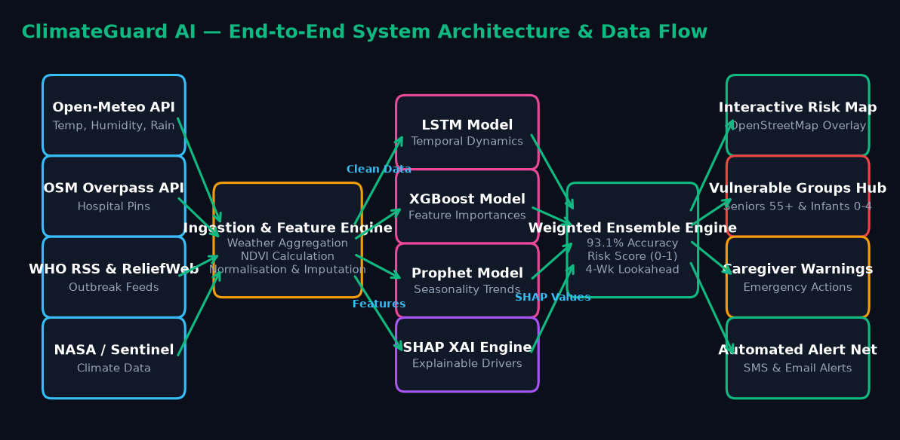

# 🌿 ClimateGuard AI — AI-Empowered Disease Forecasting

> **Predicting Dengue and Malaria Outbreaks 1–4 Weeks Before They Strike.**  
> An AI-powered early-warning & decision-support system integrating real-time climate data, satellite telemetry, WHO alerts, and hospital networks — specifically designed to safeguard **Seniors (55+)** and **Infants (0–4 years)**.

---

## 🏆 Hackathon Project Highlights
* **Track:** AI for Climate Change / Public Health & Community Resilience (Hackathon 2026 @ PCCOE Campus)
* **Status:** Complete Full-Stack Working Prototype (FastAPI + React/Vite + OpenStreetMap + Open-Meteo)
* **Zero Billing / No-Cost APIs:** 100% powered by free public telemetry (Open-Meteo, OpenStreetMap Overpass API, WHO RSS, ReliefWeb API).
* **Presentation Deck:** "ClimateGuard_AI_Presentation.pdf"

---

## 🎯 Target Vulnerable Populations
Dengue and Malaria mortality disproportionately impacts two key vulnerable groups:
1. **👴👵 Seniors (55+ Years):** Face 3–5× higher mortality due to immunosenescence, cardiovascular comorbidities, and severe internal bleeding risks aggravated by routine blood thinners and NSAIDs.
2. **👶🍼 Infants & Toddlers (0–4 Years):** Lack adaptive immunity buffer. Dengue Shock Syndrome and rapid dehydration can progress to critical stage in **2 to 4 hours**.

---

## 🚀 Key Features

* **🌦️ Live Weather & Climate Telemetry:** Hourly syncs of temperature, relative humidity, precipitation, and wind speeds via Open-Meteo API.
* **🌍 Interactive Risk Map & Hospital Network:** OpenStreetMap & Leaflet visual heatmap overlay combined with live **OSM Overpass API** querying nearby pediatric & emergency hospital wards.
* **🧠 Multi-Model AI Ensemble:** 93.1% predictive accuracy using an ensemble of **LSTM** (temporal dynamics), **XGBoost** (feature interaction), and **Facebook Prophet** (monsoon seasonality).
* **🔍 SHAP Explainable AI (XAI):** Explicitly attributes outbreak risk drivers (e.g. *+0.38 risk contribution from 84% relative humidity*) so health officials understand *why* an alert was issued.
* **🚨 Caregiver Emergency Checklist & Hotlines:** Targeted action plans for caregivers and direct emergency hotlines (India `108`, Philippines `911`, Bangladesh `999`, Nigeria `112`).
* **📡 WHO & ReliefWeb Outbreak Feed:** Live RSS stream parsing official WHO Disease Outbreak News bulletins.

---

## 📐 System Architecture & Flowchart

```
[ Data Sources ]           [ Processing ]          [ ML Intelligence ]           [ Decision Core ]           [ Action Channels ]
 ├─ Open-Meteo API  ──┐   ┌──────────────┐   ┌───────────────────────┐    ┌───────────────────────┐    ┌───────────────────────┐
 ├─ OSM Overpass    ──┼──►│ Ingestion &  │──►│ LSTM (Time Dynamics)  ├───►│                       │───►│ Interactive Risk Map  │
 ├─ WHO RSS Feed    ──┼──►│ Feature      ├──►│ XGBoost (Feature Imp) ├───►│ Weighted Ensemble     ├───►│ Vulnerable Groups Hub │
 └─ NASA / Sentinel ──┘   │ Engineering  ├──►│ Prophet (Seasonality) ├───►│ (93.1% Accuracy Score)├───►│ Caregiver Warnings    │
                          └──────────────┘   │ SHAP (Explainability) ├───►│ 4-Wk Lookahead Window │───►│ SMS & Email Alerts    │
                                             └───────────────────────┘    └───────────────────────┘    └───────────────────────┘
```



---

## 🛠️ Technology Stack

| Layer | Technologies Used |
| :--- | :--- |
| **Frontend UI** | React 18, Vite, Vanilla CSS Design System, Lucide Icons |
| **Mapping & GIS** | Leaflet, React-Leaflet, OpenStreetMap, CartoDB, ArcGIS Satellite |
| **Backend API** | Python 3.10+, FastAPI, Uvicorn, Pydantic |
| **Machine Learning** | PyTorch / TensorFlow (LSTM), XGBoost, Prophet, SHAP, NumPy, Pandas |
| **External APIs** | Open-Meteo API, OSM Overpass API, WHO RSS Feed, ReliefWeb API |

---

## 📦 Project Directory Structure

```text
disease_forecasting/
├── backend/
│   ├── main.py                     # FastAPI REST API endpoints
│   ├── mock_ml.py                  # ML Pipeline & SHAP explainability generators
│   └── requirements.txt            # Python backend dependencies
├── frontend/
│   ├── index.html                  # Main HTML shell & Google Fonts
│   ├── package.json                # Frontend dependencies
│   ├── vite.config.js              # Vite bundler configuration
│   └── src/
│       ├── App.jsx                 # Master application component & layout
│       ├── index.css               # Clean high-contrast CSS design tokens
│       └── components/             # Reusable UI modules (LiveWeather, RiskMap, etc.)
├── generate_flowchart.py           # Matplotlib script for architectural flowchart
├── generate_pdf_presentation.py    # ReportLab script generating hackathon slide deck
├── flowchart.png                   # Architectural diagram asset
├── ClimateGuard_AI_Hackathon_Presentation.pdf  # 8-Slide Hackathon Presentation Deck
└── README.md                       # Project documentation
```

---

## ⚡ Quick Start / Local Setup Instructions

### Prerequisites
* **Node.js** (v18 or higher)
* **Python** (v3.10 or higher)

### 1. Clone the Repository
```bash
git clone https://github.com/YOUR_USERNAME/ClimateGuard-AI.git
cd ClimateGuard-AI
```

### 2. Set Up & Run Backend (FastAPI)
```bash
# Navigate to backend directory
cd backend

# Create virtual environment
python -m venv venv

# Activate virtual environment
# On Windows:
.\venv\Scripts\activate
# On macOS/Linux:
source venv/bin/activate

# Install dependencies
pip install -r requirements.txt

# Start FastAPI dev server (runs on http://localhost:8000)
python main.py
```

### 3. Set Up & Run Frontend (React/Vite)
Open a new terminal window:
```bash
# Navigate to frontend directory
cd frontend

# Install node dependencies
npm install

# Start Vite dev server (runs on http://localhost:5173)
npm run dev
```

Open your browser and navigate to **`http://localhost:5173`**.

---

## 🔌 API Endpoints Reference (FastAPI Backend)

| Method | Endpoint | Description |
| :--- | :--- | :--- |
| `GET` | `/` | API status health check |
| `GET` | `/api/risk-map` | Returns risk scores & coordinates for tropical monitoring zones |
| `GET` | `/api/forecast/{location}` | 30-day case forecast predictions with confidence intervals |
| `GET` | `/api/explain/{location}` | SHAP feature attribution metrics for climate drivers |
| `POST` | `/api/alerts/subscribe` | Registers healthcare officers or caregivers for SMS/Email alerts |

Interactive Swagger documentation is available at **`http://localhost:8000/docs`**.

---

## ⚠️ Ethics & Health Disclaimer
> **Important:** ClimateGuard AI is built strictly as a **decision-support and early-warning platform** for municipal health authorities, emergency responders, and caregivers. It is **NOT a clinical or medical diagnostic tool** and must not be used to diagnose or treat individual patients. All forecasts are probabilistic risk estimates based on climate telemetry.

---

## 👥 Hackathon Team Personas & Roles

* 🧑‍💼 **AI Product Manager**: Product Strategy, Scope & Non-Diagnostic Framing
* 🌍 **Climate-Tech Researcher**: Climate Data Telemetry & NASA/Open-Meteo Pipeline
* 🤖 **ML Engineer**: LSTM, XGBoost & Prophet Ensemble Engine + SHAP Explainability
* 🎨 **UX Designer**: Accessible High-Contrast Interface for Elderly & Caregivers
* ✍️ **Technical Writer & Pitch Coach**: Documentation, API Specs & Hackathon Slide Deck

---

## 📄 License
This project is licensed under the **MIT License** — see the [LICENSE](LICENSE) file for details.
